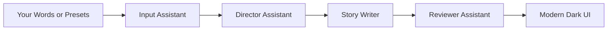

<div align="center">

# 🤖 NexusNarrative
### Smart Multi-Agent Story Studio

[](https://agentic-story-studio.streamlit.app/)
[](https://python.org)
[](https://streamlit.io)
[](https://github.com/astral-sh/uv)
[](./specs.md)
[](#)
[](https://github.com/SainBux-HadiSeelro)

<p align="center">
  <b>A modern and interactive story maker that turns your words into fun stories using smart AI assistants.</b>
</p>

🚀 **[Open Live Story Studio](https://agentic-story-studio.streamlit.app/)** • [Read The Full Specs](./specs.md) • [View Code](./mad_libs.py)

</div>

---

> [!TIP]
> 🌐 **Try it Live in your browser:** [https://agentic-story-studio.streamlit.app/](https://agentic-story-studio.streamlit.app/)  
> No installation required! Experience the smart multi-agent story pipeline in action instantly.

---

## 🌟 What Is NexusNarrative?

**NexusNarrative** is a modern take on the classic Mad Libs game. Instead of just pasting words into sentences, it uses a team of **smart software assistants** that work together:

1. **Input Assistant:** Cleans and checks the words you provide.
2. **Director Assistant:** Selects the best story template based on the theme you choose.
3. **Story Writer:** Puts your words into the story and highlights them with glowing badges.
4. **Reviewer Assistant:** Reads the final story, scores its quality, and writes friendly feedback.
5. **Saved Stories Vault:** Keeps track of every story you make so you can read or download them anytime.

---

## 🧩 How It Works



---

## ✨ Features You Will Love

- 🎨 **Modern Dark Design:** Beautiful glass cards with glowing blue highlights for your words.
- ⚡ **One-Click Presets:** Don't want to type? Pick presets like *AI Researcher*, *Programmer*, or *Space Explorer*.
- 📊 **Story Scorecard:** See total word count, story score, and estimated reading time.
- 🤖 **Helpful AI Feedback:** Get encouraging notes on your story's creativity and flow.
- 📜 **Story History:** All your stories are saved in the session so you never lose them.
- 📥 **Easy Downloads:** Download your favorite stories as Markdown (`.md`) or text files (`.txt`).

---

## 📁 Project Files

```text
1_mad_libs/
├── mad_libs.py          # Main application code with Streamlit and agents
├── specs.md             # Easy-to-read technical specifications
├── README.md            # Project description and quickstart guide
├── pyproject.toml       # Project configuration and author information
└── uv.lock              # Fast, locked dependencies
```

---

## 🚀 How To Run The Project

### Option A: Try Online (Instant Access)
Open the deployed cloud application in any browser:
👉 **[agentic-story-studio.streamlit.app](https://agentic-story-studio.streamlit.app/)**

### Option B: Run Locally with UV

#### Step 1: Open Terminal
Open your terminal inside this folder:
```bash
cd "1_mad_libs"
```

#### Step 2: Run with UV (Fast & Automatic)
Run this single command:
```bash
uv run streamlit run mad_libs.py
```

#### Step 3: Enjoy!
The application will automatically open in your browser at:
`http://localhost:8501`

---

## 🛠️ Errors Solved From The Original Code

1. **Fixed Private Method:** Changed `st.sidebar._text_input` to the correct public function `st.sidebar.text_input`.
2. **Fixed Missing Commas:** Added commas between story templates in the Python list so stories don't accidentally merge into one giant text block.
3. **Saved Story History:** Added session state so stories don't disappear when you click something else on the screen.
4. **Input Validation:** Added a friendly reminder if any input box is left empty.

---

## 👨‍💻 Created By

**Hadi Seelro**  
*Agentic AI Developer & Software Engineer*  

- 🌐 Live App: [agentic-story-studio.streamlit.app](https://agentic-story-studio.streamlit.app/)
- 🌐 GitHub: [@SainBux-HadiSeelro](https://github.com/SainBux-HadiSeelro)
- 🚀 Repository: [agentic-story-studio](https://github.com/SainBux-HadiSeelro/agentic-story-studio)
- 💖 Made with Python 3.12 and Streamlit for the AI Developer Portfolio.
