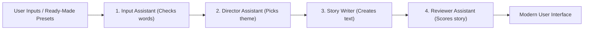

# 📐 Project Specification: NexusNarrative

**Project Name:** NexusNarrative - Smart Story Studio  
**Version:** `2.0.0`  
**Creator:** Hadi Seelro  
**Role:** Agentic AI Developer  
**Built With:** Python 3.12, Streamlit, UV  

---

## 1. Project Overview

**NexusNarrative** is an upgraded version of the classic Mad Libs game. Instead of simply joining words together, it uses a multi-agent workflow where different small software assistants work together to create, check, and display creative stories.

### Key Goals:
- **Easy to use:** Anyone can type a few words or click a ready-made preset to get a story immediately.
- **Smart agent pipeline:** Simulates how modern AI systems process user input, pick story templates, and review the final output.
- **Modern appearance:** Uses a clean, modern dark layout with glowing highlights on the words entered by the user.
- **Zero bugs:** Solves common problems like missing commas, private function calls, and lost story history.

---

## 2. How The Agents Work Together

The system uses four simple assistant roles to build each story:



### The 4 Assistants:

1. **Input Assistant (`Prompt Ingestion`):**  
   Checks the words entered in the sidebar. Removes accidental spaces and makes sure no box is left empty.

2. **Director Assistant (`Theme Selector`):**  
   Selects a story template from the chosen theme (such as *The Smart Robot*, *Startup Journey*, or *The Coding Adventure*).

3. **Story Writer (`Synthesis Engine`):**  
   Inserts the user's words into the template and adds special visual formatting so the user's words glow on screen.

4. **Reviewer Assistant (`Critic Agent`):**  
   Reads the completed story, calculates total words, estimates reading time, gives a fun story score, and writes short feedback.

---

## 3. Required Input Words

Each story asks the user for 6 simple words:

| Input Field | Meaning | Simple Example |
| :--- | :--- | :--- |
| **Adjective** | A word describing how something looks or feels | *exciting, super-smart, friendly* |
| **Action Verb 1** | An action word | *build, code, discover* |
| **Action Verb 2** | A second action word | *test, teach, explore* |
| **Famous Person** | A hero, mentor, or popular name | *Hadi Seelro, Elon Musk* |
| **Cool Machine** | A device or technological tool | *laptop, robot, spaceship* |
| **Big Goal** | The main mission or objective | *help people, make the world better* |

---

## 4. Feedback & Scoring Formulas

The Reviewer Assistant calculates simple, clear statistics for every story:

1. **Word Count:** Total number of words in the story.
2. **Story Score:** A quality rating from 75 to 99 out of 100 based on word count and creativity level.
3. **Story Flow:** Measures how smoothly the story reads (between 70% and 100%).
4. **Estimated Reading Time:** Calculates how many seconds it takes an average person to read the story.
5. **Review Comments:** Generates friendly and helpful comments based on the selected creativity level.

---

## 5. User Interface & Design System

- **Background:** Deep dark theme (`#0b0f19`) with soft gradient colors.
- **Cards:** Semi-transparent glass boxes with subtle borders and rounded corners.
- **Word Glow:** User words are highlighted with bright blue badges (`#00d2ff`) so they stand out in the story.
- **Action Buttons:** Large, simple buttons to create the story and download it as Markdown or Plain Text.

---

## 6. Solved Issues From The Old Code

| Old Problem | Why It Was An Issue | How It Was Fixed |
| :--- | :--- | :--- |
| **`st.sidebar._text_input`** | Used an internal private function that caused errors in newer Streamlit versions. | Changed to the public standard function `st.sidebar.text_input`. |
| **Missing commas in lists** | Python accidentally merged all story templates into one long string because commas were missing. | Added proper commas between all template strings. |
| **Lost stories on refresh** | Clicking anything on the page made the previous story disappear. | Stored generated stories in `st.session_state` to keep a complete history. |
| **No validation** | Leaving a box empty caused broken, awkward sentences. | Added a check to warn the user if any word is missing before creating the story. |

---

## 7. How To Test & Run

Run the project with a single command:

```bash
uv run streamlit run mad_libs.py
```

The app will open in your web browser at `http://localhost:8501`.
